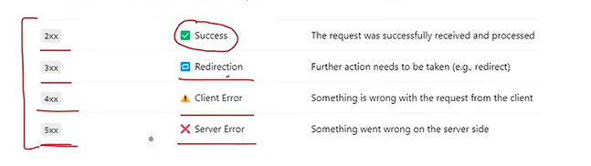

# Information and Bullet points about Fast api 

A)  wsgi vs asgi 

WSGI uses the synchronous nature. It means we can't process more than one request (ex : gunicorn), whereas ASGI, which is used by uvicorn and Fast API, can process multiple requests as well as parallel requests. 

A1)  TO run in terminal `uvicorn main:app -- reload`  main as in python file name 

B) the `docs` 

First, the API has a `/docs` endpoint, which gives you all the endpoints on one page. 
=> `http://127.0.0.1:8000/docs`

C) HTTP CODES

