# ML ROCK 
 The purpose of this repo is to provide practical coding practices and code related to ML and DL 

# Flow chart in which to follow

```mermaid 

flowchart TD
    %% Styling
    classDef main fill:#1e293b,stroke:#38bdf8,stroke-width:2px,color:#f8fafc,font-weight:bold;
    classDef sub fill:#0f172a,stroke:#64748b,stroke-width:1px,color:#cbd5e1;

    %% Step 1
    A["1. Data Gathering & Storage"]:::main
    A_sub["• Formats: CSV, TSV, JSON, SQL, Parquet<br>• Web Scraping (BeautifulSoup, Requests)<br>• REST APIs"]:::sub
    A --> A_sub

    %% Step 2
    A_sub --> B["2. Exploratory Data Analysis (EDA) & Profiling"]:::main
    B_sub["• Univariate Analysis (KDE, Boxplots, Skewness)<br>• Bivariate & Multivariate Analysis (Correlations, Pairplots)<br>• Automated Profiling (ydata-profiling)"]:::sub
    B --> B_sub

    %% Step 3
    B_sub --> C["3. Feature Engineering & Preprocessing"]:::main
    C_sub["• Missing Value Imputation (CCA, KNN, MICE)<br>• Outlier Handling (IQR, Z-Score, Winsorization)<br>• Categorical Encoding (OHE, Ordinal, Target)<br>• Scaling & Transformations (Z-score, MinMax, Box-Cox)<br>• Feature Selection (Filter, Wrapper, Embedded)<br>• Production Pipelines (ColumnTransformer, Pipeline)"]:::sub
    C --> C_sub

    %% Step 4
    C_sub --> D["4. Supervised Model Training"]:::main
    D_sub["• Linear Regression (OLS, GD, Ridge, Lasso, ElasticNet)<br>• Logistic Regression (MLE, Softmax)<br>• K-Nearest Neighbors (KNN)<br>• Support Vector Machines (SVM & Kernels)<br>• Naive Bayes (Gaussian, Multinomial, Bernoulli)<br>• Decision Trees (Cart, Entropy, Pruning)"]:::sub
    D --> D_sub

    %% Step 5
    D_sub --> E["5. Ensemble & Advanced Modeling"]:::main
    E_sub["• Voting & Stacking (Meta-learners, Blending)<br>• Bagging (Random Forests, OOB Evaluation)<br>• Boosting (AdaBoost, Gradient Boosting, XGBoost)<br>• Unsupervised Learning & Dim Reduction (K-Means, DBSCAN, PCA)"]:::sub
    E --> E_sub

    %% Step 6
    E_sub --> F["6. Model Validation & Evaluation"]:::main
    F_sub["• Cross-Validation (K-Fold, Stratified, TimeSeries)<br>• Metrics: MAE, MSE, RMSE, R²<br>• Metrics: Confusion Matrix, Precision, Recall, F1, ROC-AUC"]:::sub
    F --> F_sub

    %% Step 7
    F_sub --> G["7. Hyperparameter Optimization"]:::main
    G_sub["• Exhaustive Search (GridSearchCV)<br>• Randomized Search (RandomizedSearchCV)<br>• Probabilistic Search (Bayesian Optimization)"]:::sub
    G --> G_sub
```

 ## RULES 

 1)  AI will not be used in writing or pushing or updating the code everything will be manual 

